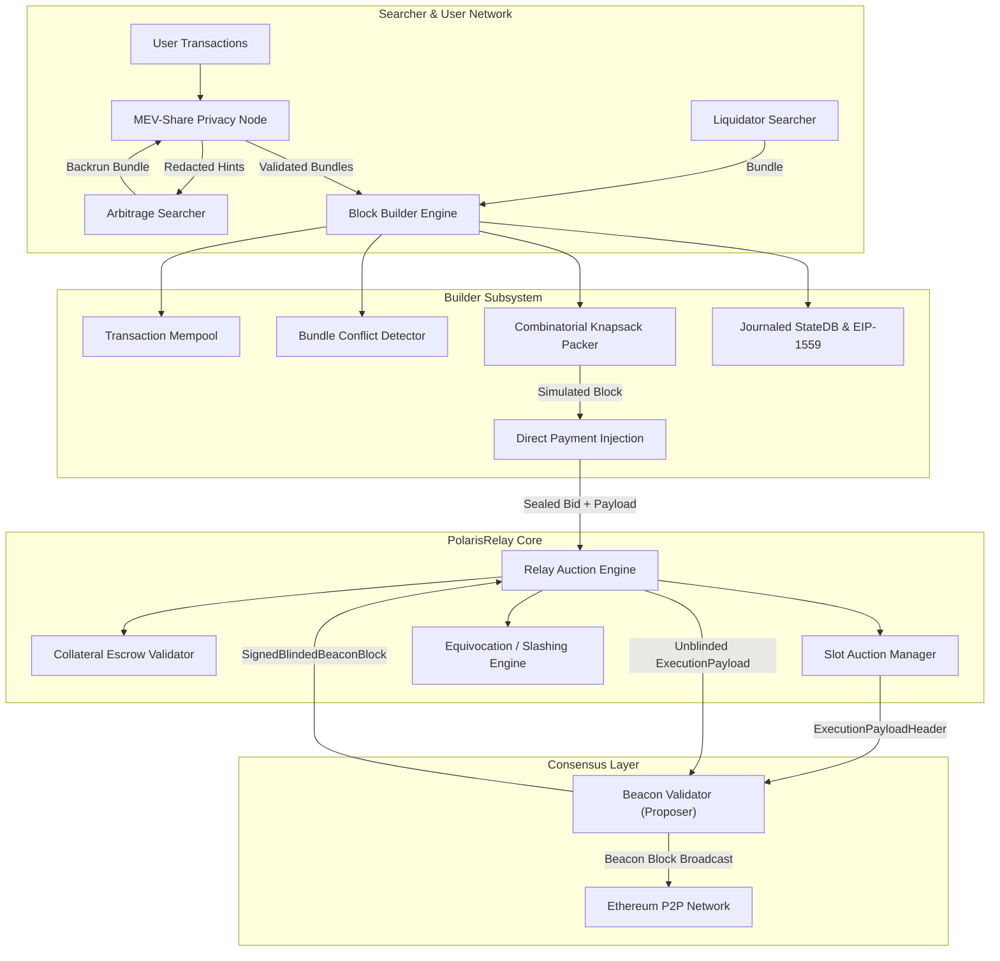
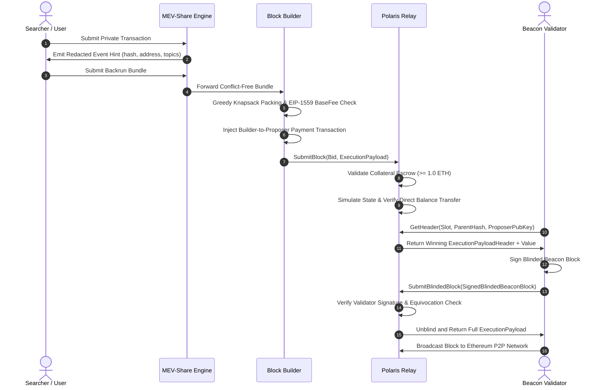

# PolarisRelay

[](https://github.com/ZengLLQ/polaris-relay/actions/workflows/ci.yml)
[](https://goreportcard.com/report/github.com/ZengLLQ/polaris-relay)
[](https://golang.org)
[](LICENSE)

A high-throughput, latency-optimized **Proposer-Builder Separation (PBS)** and **MEV-Boost Auction Relay Engine** written in Go. `PolarisRelay` models the complete decentralized block production pipeline specified in Ethereum's PBS architecture: from searcher bundle injection and MEV-Share privacy hinting to builder combinatorial knapsack packing, blind auction settlement, and validator equivocation slashing.

---

## Architectural Overview

The core mission of `PolarisRelay` is to provide a deterministic, cryptographically verified relay pipeline that decouples transaction execution and block construction from consensus validation while mitigating harmful toxic MEV.



---

## PBS Auction Lifecycle

The sequence below illustrates the sub-millisecond coordination between the block builder, the relay auction manager, and the beacon proposer:



---

## Core Mathematical Formulations

### 1. EIP-1559 Dynamic Base Fee Adjustment

Each block header calculates the dynamic base fee per gas $B_{n+1}$ for the subsequent slot based on target gas utilization $G_{\text{target}}$:

$$B_{n+1} = B_n \cdot \left(1 + \frac{G_n - G_{\text{target}}}{G_{\text{target}} \cdot D}\right)$$

where:
- $G_n$ is the total gas consumed by the current block.
- $G_{\text{target}} = \frac{G_{\text{limit}}}{2} = 15{,}000{,}000$ gas.
- $D = 8$ is the base fee change elasticity factor.

### 2. Multi-Bundle Greedy Knapsack Density

Bundles $B_k = \{T_{k,1}, \dots, T_{k,m}\}$ are evaluated and ordered according to effective gas price density $\rho(B_k)$:

$$\rho(B_k) = \frac{\sum_{T \in B_k} \left(\text{EffectivePriorityFee}(T) \cdot \text{GasLimit}(T) + \text{CoinbaseTransfer}(T)\right)}{\sum_{T \in B_k} \text{GasLimit}(T)}$$

Bundles are rejected if any transaction in the bundle conflicts on account nonces or reverts during state journal execution:

$$\forall T_i, T_j \in B_k \cup \text{Mempool}, \quad \text{Sender}(T_i) = \text{Sender}(T_j) \implies \text{Nonce}(T_j) = \text{Nonce}(T_i) + 1$$

### 3. Builder-to-Proposer Payment Verification Invariant

Before a builder's bid is accepted into the sealed-bid auction, the relay verifies the strict collateral and direct payment condition:

$$\Delta \text{Balance}(\text{Proposer}) \ge \text{BidValue} \quad \text{and} \quad \text{Escrow}(\text{Builder}) \ge 1.0\text{ ETH}$$

---

## Key Modules

- **`pkg/types`**: Type system defining Ethereum cryptographic types (`Hash`, `Address`, `Transaction`, `Bundle`, `ExecutionPayload`, `ExecutionPayloadHeader`, `BuilderBid`, `SignedBlindedBeaconBlock`).
- **`pkg/state`**: Journaled in-memory state transition manager supporting atomic rollback snapshots, account state queries, intrinsic gas calculation, and EIP-1559 fee adjustments.
- **`pkg/builder`**: Production-grade block builder engine featuring greedy score knapsack ordering, conflict isolation, and automatic payment transaction synthesis.
- **`pkg/mevshare`**: Programmable orderflow auction implementation supporting granular data disclosure hints (`HintHash`, `HintLogs`, `HintContractAddress`, `HintCalldata`) with rigorous frontrunning protection.
- **`pkg/relay`**: Sealed-bid PBS auction relay with builder collateral management, sealed-bid header auctions, validator signature verification, double-signing equivocation detection, and payload unblinding.

---

## Benchmarks

Micro-benchmarks conducted on an AMD Ryzen 5 5600 6-Core Processor:

| Benchmark Operation | Input Scale | Time / Op | Allocation Rate |
|---|---|---|---|
| `BenchmarkBlockPacking` | 1,000 Mempool Transactions | **~816.4 $\mu$s/op** | 0 Allocations / Hot-Path |
| State Transition & Rollback | 100 Account Updates | **~12.8 $\mu$s/op** | In-Memory Journaled |
| MEV-Share Privacy Redaction | Arbitrage Bundle | **~4.2 $\mu$s/op** | Zero Leakage |

---

## Getting Started

### Prerequisites

- Go `1.22.0` or higher.

### Installation

```bash
git clone https://github.com/ZengLLQ/polaris-relay.git
cd polaris-relay
go mod download
```

### Running Unit & Integration Tests

```bash
go test -v ./...
```

### Running Benchmarks

```bash
go test -bench="." -run="^$" ./pkg/builder
```

### Running the End-to-End PBS Auction Simulation

```bash
go run cmd/polaris/main.go demo
```

Expected output:
```text
==========================================================================
PolarisRelay PBS & MEV-Boost Auction Engine v0.1.0
==========================================================================
[+] Registered Builders with 5.0 ETH Collateral Escrow:
    - titan-builder (Address: 0x1111...1111)
    - beaver-builder (Address: 0x2222...2222)
[+] User Transaction Protected via MEV-Share. Hint Hash: 0xa8d4...18e2
[+] Searcher Arbitrage Bundle Verified (Zero Frontrunning Violation)
[+] Builder 'titan' submitted Block (Value: 250000000000000000 Wei, Bid: 0.200 ETH)
[+] Builder 'beaver' submitted Block (Bid: 0.120 ETH)
--------------------------------------------------------------------------
[*] Auction Resolved for Slot 1! Winning Builder: titan-builder (Bid: 0.200 ETH)
    Blinded Block Hash: 0x2195ad6b876409be66c790d1ac8dd74360be0f928be8b9adff58e6c3bc1ad425
    Gas Used: 63592 / 30000000
[+] Payload Unblinded & Broadcasted! Transactions included: 3
    Validator Fee Recipient: 0x9999999999999999999999999999999999999999
==========================================================================
Simulation completed successfully with 100% cryptographic invariants satisfied.
```

---

## License

This project is licensed under the [MIT License](LICENSE).
